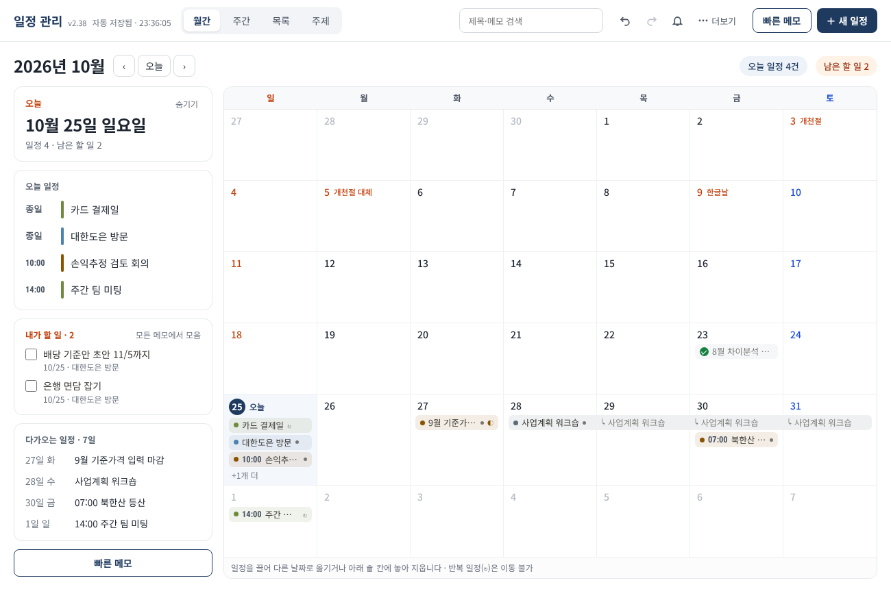
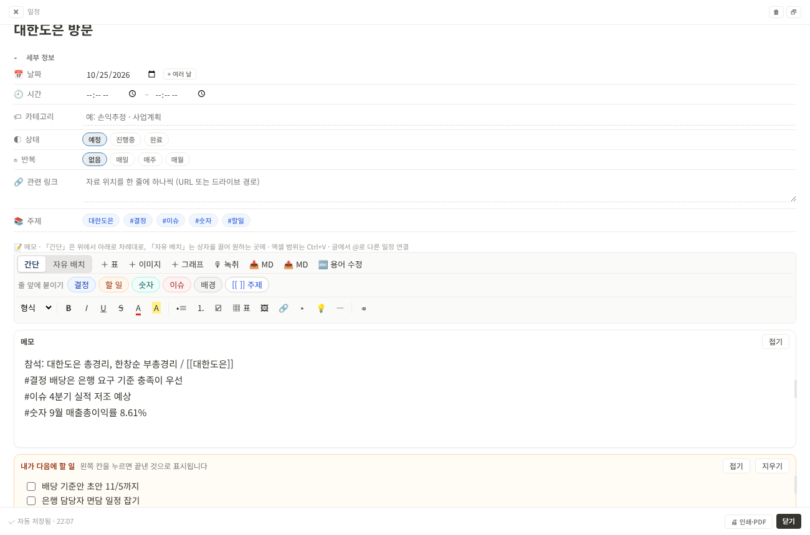
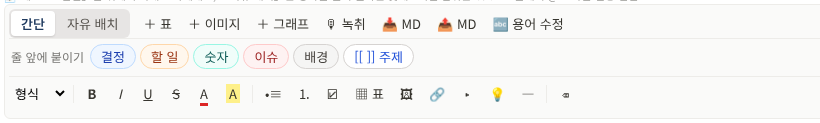
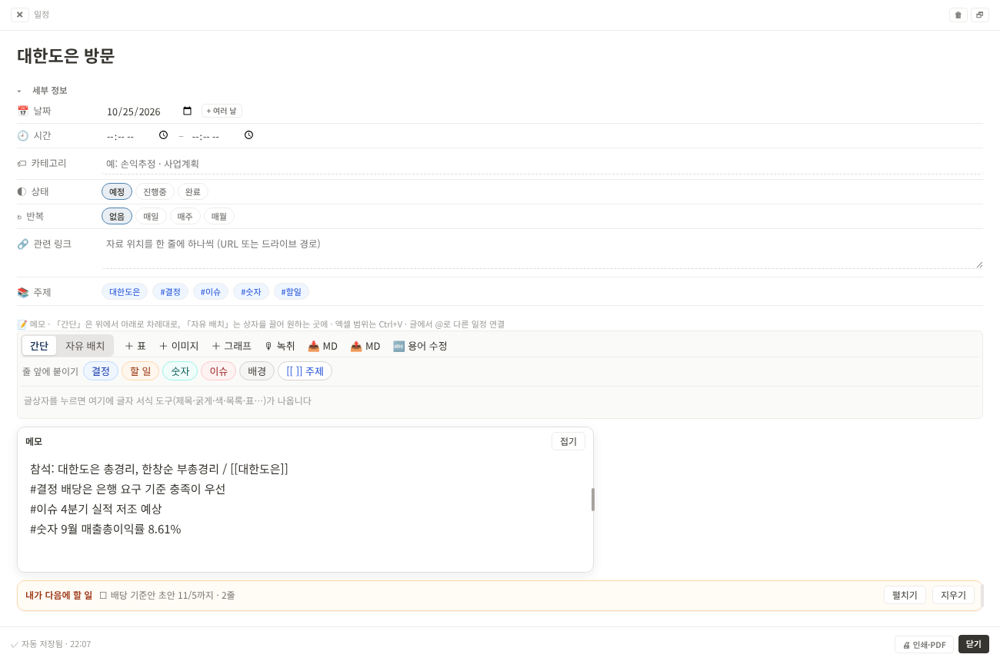
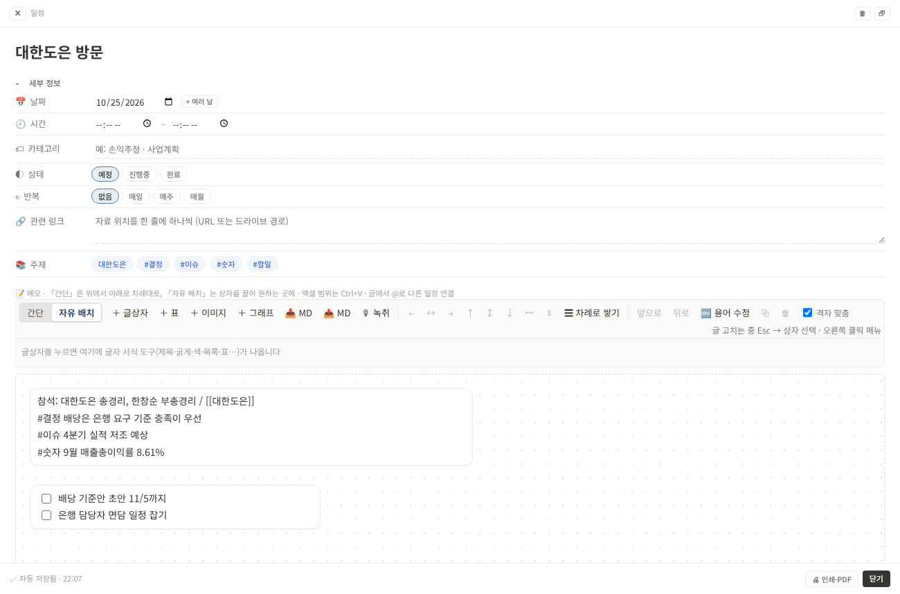
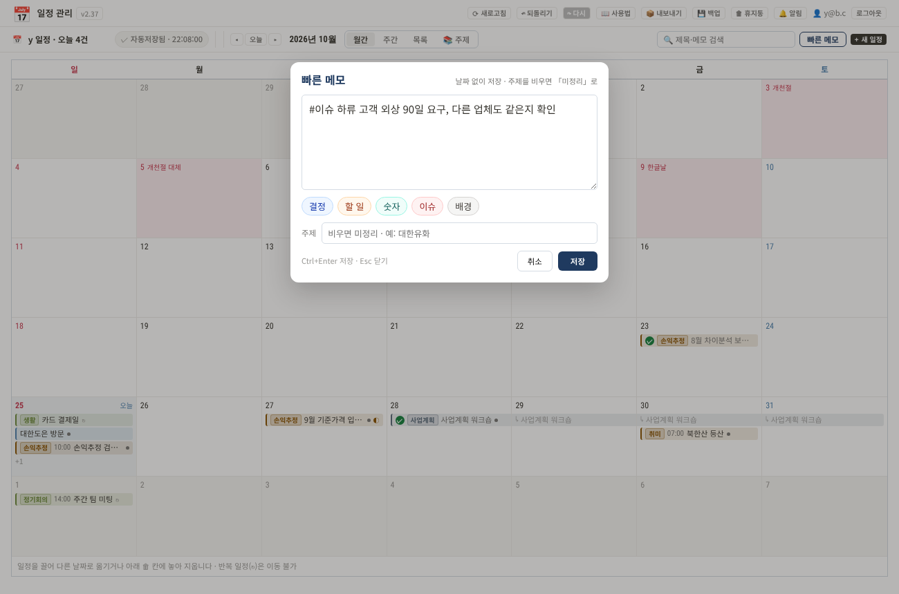
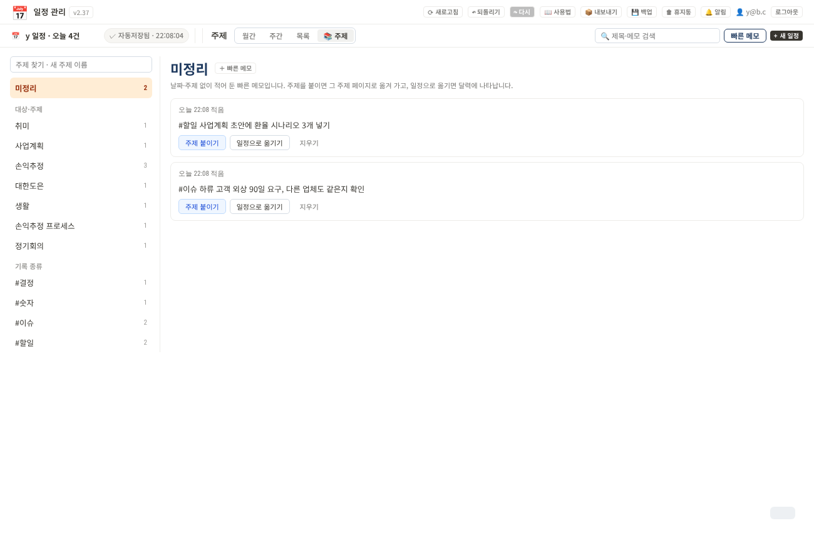
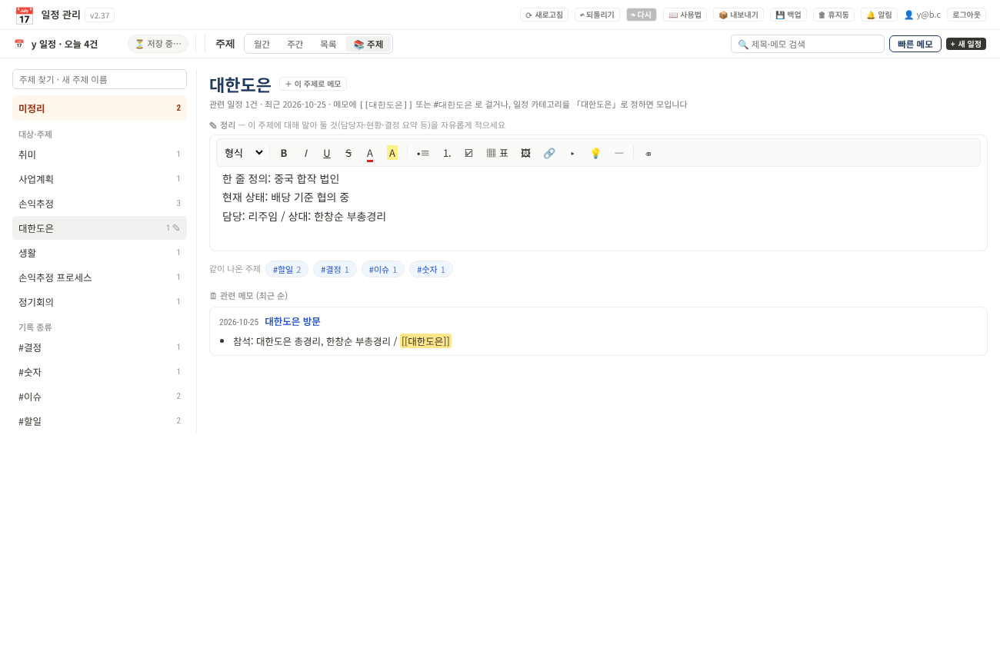
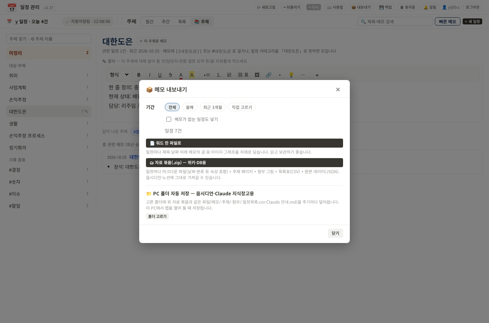
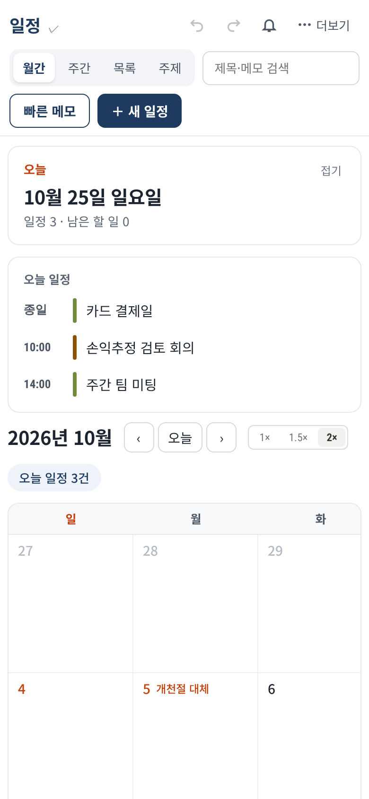

# 일정 관리 사용법

일정 관리 앱(v2.39.3) 쓰는 법을 한곳에 모았습니다. 앱 맨 위 **더보기 › 사용법**을 누르면 언제든 이 글을 다시 볼 수 있습니다.

## 1. 화면 한눈에 보기

| 위치 | 하는 일 |
|---|---|
| 맨 위 왼쪽 | 앱 이름, 저장 상태(「자동 저장됨 · 시각」) |
| 맨 위 가운데 | 보기 바꾸기: 월간 · 주간 · 목록 · 주제 |
| 맨 위 오른쪽 | 검색, ↶ 되돌리기, ↷ 다시, 🔔 알림, **더보기**(새로고침 · 사용법 · 내보내기 · 백업 · 휴지통 · 로그아웃), 빠른 메모, ＋ 새 일정 |
| 달 제목 옆 | ‹ › 로 달 넘기기, 「오늘」(오늘 칸 여닫기), 「남은 할 일 N」 |

### 「오늘」 칸

월간·주간 보기 왼쪽(휴대폰은 달력 위)에 오늘 한 일을 모아 보여 줍니다.

- **오늘 일정**: 시간순으로 보이고, 다음에 할 일정에는 「다음」 표시가 붙습니다. 누르면 그 일정이 열립니다.
- **내가 할 일**: 모든 메모의 「내가 다음에 할 일」 칸에서 아직 끝내지 않은 줄을 모읍니다. 네모를 누르면 그 메모에서도 끝낸 것으로 표시됩니다(↶ 로 되돌리기 가능). 아래 회색 글자를 누르면 그 메모가 열립니다.
- **다가오는 일정**: 앞으로 7일 안의 일정입니다.
- 달 제목 옆 ‹ **오늘** › 의 「오늘」을 누르면 오늘 칸이 열리고(단추가 남색으로 채워짐), 한 번 더 누르면 닫힙니다. 다른 달을 보고 있을 때 누르면 이번 달로 돌아오며 칸이 열립니다. 칸 안의 「숨기기」·「접기」도 쓸 수 있습니다. 휴대폰에서는 「접기」로 줄입니다.

- 일정 꼬리표를 끌어 다른 날짜에 놓으면 옮겨지고, 달력 아래 🗑 칸에 놓으면 지워집니다. 반복 일정(↻)은 끌어 옮길 수 없습니다.
- 오늘 날짜는 남색 동그라미, 공휴일은 빨간 글자로 표시됩니다.
- 끝낸 일정은 취소선 대신 제목 앞에 **초록 체크(✓)**가 붙고 글자가 흐려집니다.
- 저장은 자동입니다. 왼쪽 위에 「자동저장됨 · 시각」이 보이면 저장된 것입니다.

## 2. 일정 만들고 고치기

1. **＋ 새 일정**을 누르거나 달력의 빈 칸을 누릅니다.
2. 제목을 쓰면 그때부터 자동 저장됩니다.
3. **세부 정보**를 펼쳐 날짜·시간·카테고리·상태·반복·관련 링크를 정합니다.
   - **상태**에서 「완료」를 고르면 달력에 체크 표시가 붙습니다.
   - **카테고리**는 그대로 **주제**가 됩니다. 「대한유화」로 정하면 이 일정이 📚 주제 › 대한유화 페이지에 모입니다.
4. 다 쓰면 **닫기**를 누릅니다.

## 3. 메모 쓰기 — 「간단」 보기

일정마다 메모가 하나 있습니다. 메모 위의 **간단 / 자유 배치** 단추로 보는 방식을 고릅니다. 새 일정은 「간단」으로 열립니다.

- **간단**: 공책처럼 위에서 아래로 이어 씁니다. 회의 중 받아 적기나 휴대폰에서 쓰기에 좋습니다.
- **자유 배치**: 화이트보드처럼 글상자·표·그래프·이미지를 끌어 원하는 자리에 놓습니다.
- 두 보기는 같은 메모를 보여 주는 방식만 다릅니다. 언제 바꿔도 내용이 지워지지 않습니다.

### 줄 앞 표시 붙이기

글을 쓰다가 **결정 · 할 일 · 숫자 · 이슈 · 배경** 단추를 누르면 커서가 있는 줄 맨 앞에 `#결정` 같은 표시가 붙습니다. 같은 단추를 한 번 더 누르면 뗍니다. 표시를 외워서 칠 필요가 없습니다. 표시가 붙은 줄은 종류별 색 띠(결정 파랑, 할 일 주황, 숫자 청록, 이슈 빨강, 배경 회색)로 보여 한눈에 찾을 수 있습니다.

| 표시 | 언제 쓰나 |
|---|---|
| #결정 | 정해진 것 |
| #할일 | 누가 언제까지 할 일 |
| #숫자 | 기억해 둘 수치 |
| #이슈 | 문제·위험 |
| #배경 | 왜 그렇게 됐는지 |

- 해당되는 줄에만 붙이면 됩니다. 모든 줄에 붙일 필요는 없습니다.
- **[[ ]] 주제** 단추는 `[[ ]]`를 넣고 커서를 그 안에 둡니다. 회사·사람·프로젝트 이름을 쓰면 그 주제 페이지에 이 줄이 모입니다.

### 내가 다음에 할 일

메모 아래 주황색 칸입니다. **＋ 할 일 추가**를 누르고 한 줄씩 적으면 자동으로 #할일로 모입니다. 왼쪽 네모를 누르면 끝낸 것으로 표시됩니다.

### 상자 접기 · 크기 조절

- 상자 오른쪽 위 **접기**를 누르면 첫 줄만 남기고 접힙니다. **펼치기**로 다시 엽니다. 접은 상태는 기억됩니다.
- 상자 **아래쪽 가장자리**의 회색 막대를 끌면 높이가 바뀝니다. 내용이 더 길면 상자 안에서 굴려 봅니다.
- 상자 **오른쪽 가장자리**의 회색 막대를 끌면 폭이, **오른쪽 아래 모서리**를 끌면 폭과 높이가 함께 바뀝니다.
- 막대나 모서리를 두 번 누르면 원래 크기로 돌아갑니다.
- 회의록·통번역 정리본처럼 긴 상자는 처음부터 접혀 있습니다.

### 표 · 이미지 · 그래프 · 녹취

- **＋ 표**: 엑셀처럼 쓰는 표가 메모 맨 아래에 들어갑니다. 엑셀에서 복사한 범위를 Ctrl+V로 붙여도 표가 됩니다.
- **＋ 이미지**: 그림 파일을 고르거나, 캡처한 그림을 Ctrl+V로 붙입니다.
- **＋ 그래프**: 보기 표와 함께 들어가고, 표를 고치면 그래프도 바뀝니다.
- **🎙 녹취**: 메모 안에 통번역 녹음 화면을 띄웁니다. 정지하면 정리본이 그 자리에 들어옵니다.
- **📥 문서**: 한글(.hwp·.hwpx), 워드(.docx), 엑셀(.xlsx·.xls), 파워포인트(.pptx), PDF, 마크다운(.md) 파일을 글상자로 불러옵니다. 표는 표로(합친 칸 포함), 그림은 이미지 상자로 들어옵니다. 메모에 파일을 끌어다 놓아도 됩니다. 변환은 내 기기 안에서만 하고, 처음 한 번은 변환 부품을 내려받느라 조금 걸립니다(PDF는 처음에 더 걸립니다). 옛 형식인 .doc·.ppt는 못 읽으니 .docx·.pptx로 저장해서 넣으세요. 테두리 없는 PDF 표는 글로 들어옵니다.
- **📤 내보내기**: 이 메모를 한글(.hwpx), 워드(.docx), PDF, 마크다운(.md) 가운데 골라 파일로 저장합니다. 워드는 그림과 표까지 들어가고, 한글은 그림이 빠집니다. PDF는 인쇄 화면이 열리면 프린터를 「PDF로 저장」으로 고르세요. 옛 .hwp가 필요하면 한글 프로그램에서 .hwpx를 열고 다른 이름으로 저장하세요. 여러 일정을 한꺼번에 뽑을 때는 더보기 › 내보내기를 쓰세요.
- **🔤 용어 수정**: 잘못 받아쓴 이름·용어를 메모 전체에서 한꺼번에 바꿉니다.
- 글에서 `@`를 치면 다른 일정을 골라 연결할 수 있습니다.

## 4. 「자유 배치」 보기

- 상자 위 ⠿ 손잡이를 끌어 옮기고, 모서리를 끌어 크기를 바꿉니다.
- 여러 상자를 고른 뒤 맞춤 단추로 줄을 맞춥니다. **☰ 차례로 쌓기**는 흩어진 상자를 위에서부터 겹치지 않게 쌓습니다.
- 「간단」에서 넣은 상자는 자유 배치에서 기존 상자들 아래에 놓입니다.
- **🖨 인쇄·PDF**(Ctrl+P)는 지금 보이는 배치 그대로 종이에 옮깁니다.

## 5. 빠른 메모 — 날짜 없이 바로 적기

1. 위쪽 **빠른 메모**를 누릅니다.
2. 생각나는 것을 적고, 필요하면 결정·할 일 같은 단추를 누릅니다.
3. **주제**를 고르면 그 주제 페이지로, 비워 두면 **미정리**로 갑니다.
4. **저장**(Ctrl+Enter)을 누릅니다.

빠른 메모는 달력과 알림에는 나오지 않습니다.

미정리에서 할 수 있는 것:

- **주제 붙이기**: 이름을 고르면 그 주제 페이지로 옮겨 갑니다.
- **일정으로 옮기기**: 오늘 날짜 일정이 되어 달력에 나타납니다. 날짜는 세부 정보에서 고칩니다.
- **지우기**: 지운 뒤에도 ↶ 되돌리기로 살릴 수 있습니다.

## 6. 📚 주제 페이지 (개인 위키)

- 메모에 `[[대한유화]]`나 `#판가협상`을 쓰거나, 일정 카테고리를 「대한유화」로 정하면 그 줄이 주제 페이지에 날짜순으로 모입니다.
- 왼쪽 목록은 **미정리 · 대상·주제 · 기록 종류(#결정·#할일 등)**로 나뉩니다.
- 주제 페이지 맨 위 **정리** 칸에는 그 대상에 대해 늘 알아 둘 것을 적습니다. 예: 한 줄 정의, 현재 상태, 담당자, 핵심 숫자.
- **＋ 이 주제로 메모**를 누르면 주제가 채워진 빠른 메모 창이 열립니다.
- 카테고리가 있는 일정의 #결정·#할일 줄은 그 카테고리 주제에도 함께 모입니다.

### 메모 쓰는 요령

- 한 줄에 한 가지 사실만 씁니다.
- 해당될 때만 줄 맨 앞에 기록 종류 표시를 붙입니다.
- 회사·사람·프로젝트 이름은 `[[ ]]`로 감쌉니다.
- 숫자에는 단위와 기준 시점을 같이 씁니다. 예: `#숫자 9월 매출총이익률 8.61%`

## 7. 내보내기 · PC 폴더 저장

- **워드 한 파일로**: 일정마다 제목·날짜와 메모를 차례로 담은 .docx 파일입니다.
- **자료 묶음(.zip)**: 메모마다 .md 파일, 주제 페이지, 첨부 그림, 일정목록.csv, data.json이 들어 있습니다. 옵시디언이나 노션으로 가져갈 수 있습니다.
- **📁 PC 폴더 자동 저장**: 폴더를 한 번 고르면 매일·매주·매월 같은 묶음을 덮어씁니다. 이 PC에서 앱을 열어 둘 때 저장됩니다. 창 왼쪽 아래에 「눌러서 허락」이 보이면 한 번 눌러 주세요.

## 8. Claude와 함께 쓰기

- PC 폴더 자동 저장으로 쌓인 폴더(메모/ · 주제/ · Claude 안내.md)를 Claude 프로젝트에 올리거나 폴더 접근을 허락하면, Claude가 지식창고처럼 읽고 답합니다.
- 「일정관리」 Claude 프로젝트 대화에서 물어보면, Claude가 앱 데이터를 직접 읽어 메모 히스토리를 정리하거나 보고서를 씁니다.
- 예: 「지난 3개월 대한유화 #결정만 모아 줘」, 「이번 주 #할일 중 안 끝난 것 정리해 줘」

## 9. 휴대폰에서

- 앱을 열면 맨 위 「오늘」 칸에 오늘 일정과 남은 할 일이 먼저 보입니다. 「접기」로 줄여 둘 수 있습니다.
- 월간 보기는 1× · 1.5× · 2× 단추로 글자 크기를 바꿀 수 있습니다.
- 메모를 쓸 때 결정·할 일 단추가 메모 아래, 화면 아래쪽에 붙어 있습니다.
- 홈 화면에 추가해 앱처럼 쓰면, 🔔 알림에서 켠 일정 알림이 폰으로 옵니다.

## 10. 되돌리기 · 휴지통 · 백업

- **↶ 되돌리기(Ctrl+Z) / ↷ 다시(Ctrl+Y)**: 방금 한 일을 취소하거나 되살립니다.
- **🗑 휴지통**(더보기 안): 지운 항목을 일정 기간 보관하고, 여기서 되살릴 수 있습니다.
- **💾 백업**(더보기 안): 전체 데이터를 JSON 파일 하나로 내려받습니다.
- **⟳ 새로고침**: 새 버전이 나왔을 때 최신 화면을 받아옵니다.
